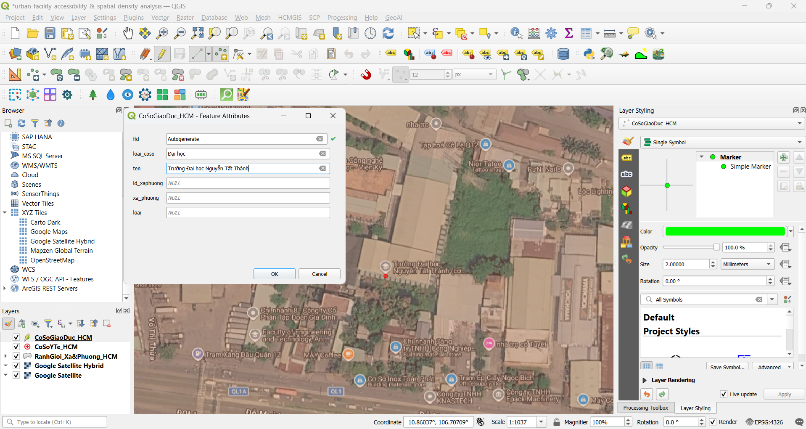
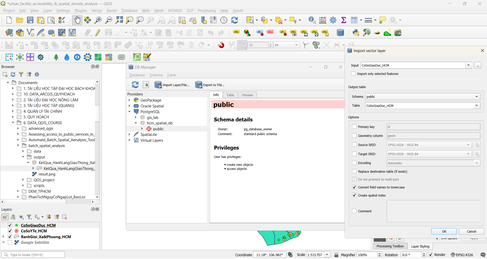
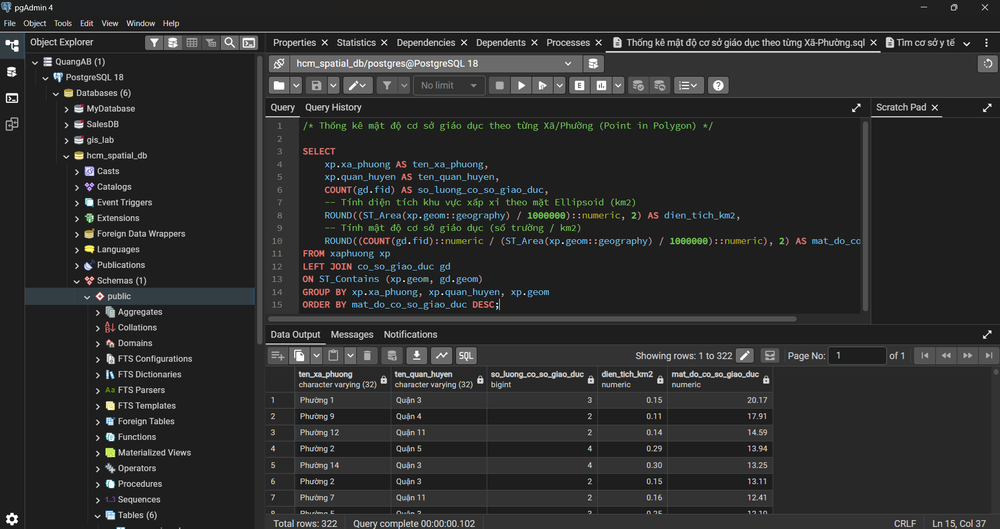
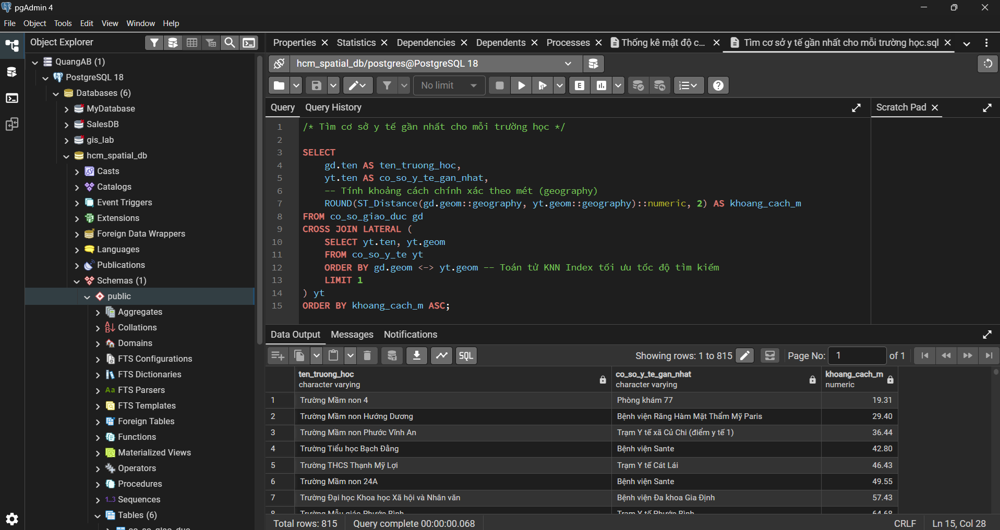
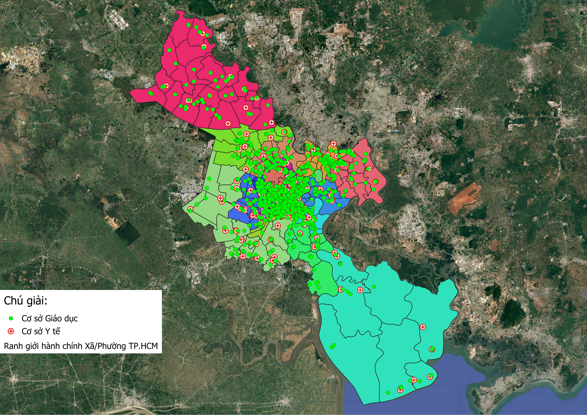

# Phân Tích Mật Độ Tiện Ích Đô Thị & Khả Năng Tiếp Cận Không Gian (PostGIS)

## 📌 Tổng quan Dự án

Dự án này đánh giá sự phân bố không gian, mật độ và khả năng tiếp cận đô thị đối với các cơ sở dịch vụ công cộng trên khắp **Thành phố Hồ Chí Minh (TP.HCM)** thông qua việc sử dụng **PostgreSQL và PostGIS**.

---

## 🎯 Mục tiêu Dự án

1. **Phân tích mật độ không gian:** Thống kê số lượng và mật độ phân bố của các cơ sở giáo dục trên từng đơn vị hành chính cấp Xã/Phường.
2. **Phân tích khả năng tiếp cận y tế khẩn cấp:** Định vị cơ sở y tế gần nhất cho mỗi trường học và tính toán khoảng cách đường chim bay thực tế theo hệ tọa độ trắc địa (Ellipsoid WGS84).
3. **Tối ưu hóa hiệu suất CSDL Không gian:** Ứng dụng chỉ mục không gian (Spatial Index), Toán tử tìm kiếm KNN (K-Nearest Neighbor) `<->` và Kỹ thuật `CROSS JOIN LATERAL` để xử lý truy vấn tốc độ cao.

---

## 🛠️ Công nghệ & Dữ liệu sử dụng

* **Cơ sở dữ liệu Không gian:** PostgreSQL (pgAdmin4) với PostGIS extension.

* **Phần mềm GIS & Quản lý dữ liệu:** QGIS 3.44.15 (DB Manager).

* **Hàm phân tích Không gian & Truy vấn:** `ST_Contains`, `ST_Area`, `::geography`, `CROSS JOIN LATERAL`, KNN (`<->`).

---

## 📊 Dữ liệu đầu vào

### 1. Dữ liệu vector

Dữ liệu Ranh giới Xã/Phường TP.HCM thu thập trên GADM (url: https://gadm.org/download_country.html).
Dữ liệu vị trí các cơ sở y tế và giao dục tại khu vực TP.HCM thu thập nguồn dữ liệu mở OpenStreetMap (OSM).

* `CoSoGiaoDuc_HCM.gpkg`: Vị trí không gian các cơ sở giáo dục tại TP.HCM (Point, 815 đối tượng)
* `CoSoYTe_HCM.gpkg`: Vị trí không gian các cơ sở y tế (Bệnh viện/Trạm y tế) tại TP.HCM (Point, 197 đối tượng).
* `RanhGioi_Xa&Phuong_HCM.gpkg`: Ranh giới hành chính Xã/Phường TP.HCM (Polygon, 322 đối tượng).

### 2. Dữ liệu cho Cơ sở Dữ liệu (Database)

* Bảng `xa_phuong`: Ranh giới hành chính Xã/Phường TP.HCM (Polygon, 322 đối tượng).
* Bảng `co_so_giao_duc`: Vị trí không gian các cơ sở giáo dục tại TP.HCM (Point, 815 đối tượng).
* Bảng `co_so_y_te`: Vị trí không gian các cơ sở y tế (Bệnh viện/Trạm y tế) tại TP.HCM (Point, 197 đối tượng).

---

## 📂 Cấu trúc thư mục Dự án

```
urban_facility_accessibility_&_spatial_density_analysis_postgis/
│
├── data/                                                              	# Dữ liệu vector đầu vào gốc (WGS84 - EPSG:4326)
│     ├── CoSoGiaoDuc_HCM.gpkg              
│     ├── CoSoYTe_HCM.gpkg
│     └── RanhGioi_Xa&Phuong_HCM.gpkg
│
├── sql/                                            
│     ├── Thống kê mật độ cơ sở giáo dục theo từng Xã-Phường.sql        # Thống kê mật độ cơ sở giáo dục theo từng Xã-Phường
│     └── Tìm cơ sở y tế gần nhất cho mỗi trường học.sql                # Tìm cơ sở y tế gần nhất cho mỗi trường học
│
├── images/                                                             
│     ├── add_data.png													# Bổ sung thủ công dữ liệu cơ sở y tế và giáo dục bị thiếu               
│     ├── add_database.png												# Nạp dữ liệu từ QGIS vào Cơ sở dữ liệu để thực hiện truy vấn
│	  ├── query_1.png													# Đoạn truy vấn Thống kê Mật độ Cơ sở Giáo dục theo Xã/Phường
│     └── query_2.png													# Đoạn truy vấn Phân tích Cơ sở Y tế gần nhất cho từng Cơ sở Giáo dục
│
├── layout/
│	  └── map.png														# Vị trí các cơ sở y tế và giáo dục tại TP.HCM
│
├── QGS_project/                                                       	# File dự án đinh dạng .qgz
│     └── urban_facility_accessibility_&_spatial_density_analysis.qgz
│
└── README.md                                                           # Tài liệu hướng dẫn và ghi nhận dự án
```

---

## ⚙️ Phương pháp Xử lý & Truy vấn SQL

### Bước 1: Chuẩn bị và Chuẩn hóa dữ liệu

Sau khi tiến hành thu thập các lớp dữ liệu (ranh giới Xã/Phường TP.HCM, cơ sở y tế và giáo dục TP.HCM), tiến hành thực hiện chuẩn hóa dữ liệu đầu vào. Kiểm tra lỗi hình học (topology), kiểm tra chất lượng của dữ liệu, bổ sung thêm những dữ liệu bị thiếu bằng thao tác số hóa thủ công thông qua vị trí ảnh vệ tinh.


*Hình 1: Bổ sung thủ công dữ liệu cơ sở y tế và giáo dục bị thiếu*

### Bước 2: Nạp dữ liệu vào Cơ sở dữ liệu

Dữ liệu sau khi đã được chuẩn hóa sẽ được nhập từ QGIS vào PostgreSQL thông qua DB Manager, trong đó các chỉ mục không gian (`Spatial Index`) được tạo trên cột hình học (`geom`) nhằm tối ưu hóa hiệu suất cho các tập dữ liệu đô thị quy mô lớn.


*Hình 2: Nạp dữ liệu từ QGIS vào Cơ sở dữ liệu để thực hiện truy vấn*

### Bước 3: Thống kê Mật độ Cơ sở Giáo dục theo Xã/Phường (Point-in-Polygon)

Tính toán số lượng cơ sở giáo dục theo từng đơn vị hành chính, xác định diện tích từng đơn vị hành chính chính xác thông qua việc chuyển đổi sang kiểu `::geography` (dựa trên mô hình ellipsoid), đồng thời đánh giá mật độ cơ sở giáo dục trên mỗi km2.

```sql
/* Thống kê mật độ cơ sở giáo dục theo từng Xã/Phường (Point in Polygon) */

SELECT
	xp.xa_phuong AS ten_xa_phuong,
	xp.quan_huyen AS ten_quan_huyen,
	COUNT(gd.fid) AS so_luong_co_so_giao_duc,
	-- Tính diện tích khu vực xấp xỉ theo mặt Ellipsoid (km2)
	ROUND((ST_Area(xp.geom::geography) / 1000000)::numeric, 2) AS dien_tich_km2,
	-- Tính mật độ cơ sở giáo dục (số trường / km2)
	ROUND((COUNT(gd.fid)::numeric / (ST_Area(xp.geom::geography) / 1000000)::numeric), 2) AS mat_do_co_so_giao_duc
FROM xaphuong xp
LEFT JOIN co_so_giao_duc gd
ON ST_Contains (xp.geom, gd.geom)
GROUP BY xp.xa_phuong, xp.quan_huyen, xp.geom
ORDER BY mat_do_co_so_giao_duc DESC;
```


*Hình 3: Kết quả Thống kê Mật độ Cơ sở Giáo dục theo Xã/Phường trên pgAdmin4*

### Bước 4: Phân tích Cơ sở Y tế gần nhất cho từng Cơ sở Giáo dục (KNN Analysis)

Xác định cơ sở y tế gần nhất cho mỗi cơ sở giáo dục tại TP.HCM và tính toán khoảng cách địa lý chính xác (theo đường chim bay) theo đơn vị mét.

```sql
/* Tìm cơ sở y tế gần nhất cho mỗi trường học */

SELECT 
    gd.ten AS ten_truong_hoc,
    yt.ten AS co_so_y_te_gan_nhat,
    -- Tính khoảng cách chính xác theo mét (geography)
    ROUND(ST_Distance(gd.geom::geography, yt.geom::geography)::numeric, 2) AS khoang_cach_m
FROM co_so_giao_duc gd
CROSS JOIN LATERAL (
    SELECT yt.ten, yt.geom
    FROM co_so_y_te yt
    ORDER BY gd.geom <-> yt.geom -- Toán tử KNN Index tối ưu tốc độ tìm kiếm
    LIMIT 1
) yt
ORDER BY khoang_cach_m ASC;
```


*Hình 4: Kết quả Phân tích Cơ sở Y tế gần nhất cho từng Cơ sở Giáo dục trên pgAdmin4*

---

## 📈 Kết quả thu được

### 1. Bảng Top 10 Xã/Phường có Mật độ Cơ sở Giáo dục lớn nhất:

Sau khi thực thi truy vấn Thống kê mật độ cơ sở giáo dục theo từng Xã/Phường (Point in Polygon) đây là kết quả thu được.

| STT | Tên Xã / Phường (`ten_xa_phuong`) | Tên Quận / Huyện (`ten_quan_huyen`) | Số lượng cơ sở giáo dục (`so_luong_co_so_giao_duc`) | Diện tích ($km^2$) (`dien_tich_km`) | Mật độ cơ sở giáo dục (`mat_do_co_so_giao_duc`) |
| :---: | :---: | :---: | :---: | :---: | :---: |
| **1** | Phường 1 | Quận 3 | 3 | 0.15 | 20.17 |
| **2** | Phường 9 | Quận 4 | 2 | 0.11 | 17.91 |
| **3** | Phường 12 | Quận 11 | 2 | 0.14 | 14.59 |
| **4** | Phường 2 | Quận 5 | 4 | 0.29 | 13.94 |
| **5** | Phường 14 | Quận 3 | 4 | 0.30 | 13.25 |
| **6** | Phường 2 | Quận 3 | 2 | 0.15 | 13.11 |
| **7** | Phường 7 | Quận 11 | 2 | 0.16 | 12.41 |
| **8** | Phường 5 | Quận 3 | 3 | 0.25 | 12.10 |
| **9** | Phường 8 | Quận 11 | 4 | 0.34 | 11.87 |
| **10** | Phường 3 | Bình Thạnh | 5 | 0.45 | 11.12 |

### 2. Bảng Top 10 Cơ sở Giáo dục có khoảng cách nhỏ nhất:

Sau khi thực thi truy vấn Phân Tích Cơ Sở Y Tế Gần Nhất Cho Mỗi Trường Học (KNN Analysis) đây là kết quả thu được.

| STT | Tên cơ sở giáo dục (`ten_truong_hoc`) | Tên cơ sở y tế gần nhất (`co_so_y_te_gan_nhat`) | Khoảng cách ($m^2$) (`khoang_cach_m`) |
| :---: | :---: | :---: | :---: |
| **1** | Trường Mầm non 4 | Phòng khám 77 | 19.31 |
| **2** | Trường Mầm non Hướng Dương | Bệnh viện Răng Hàm Mặt Thẩm Mỹ Paris | 29.40 |
| **3** | Trường Mầm non Phước Vĩnh An | Trạm Y tế xã Củ Chi (Điểm y tế 1) | 36.44 |
| **4** | Trường Tiểu học Bạch Đằng | Bệnh viện Sante | 42.80 |
| **5** | Trường THCS Thạnh Mỹ Lợi | Trạm Y tế Cát Lái | 46.43 |
| **6** | Trường Mầm non 24A | Bệnh viện Sante | 49.55 |
| **7** | Trường Đại học Khoa học Xã hội và Nhân văn | Bệnh viện Gia Định | 57.43 |
| **8** | Trường Mẫu giáo Phước Bình | Trạm Y tế Phước Bình | 64.68 |
| **9** | Trường Tiểu học Phước Vĩnh An | Trạm Y tế xã Củ Chi (Điểm y tế 1) | 66.41 |
| **10** | Trường Tiểu học Tân Hưng | Bệnh viện Đa khoa Tân Hưng | 67.76 |

---

## 📊 Ứng dụng thực tế

**Đánh giá tiếp cận:** Tìm ra các trường học ở khu vực giáp ranh hoặc vùng sâu vùng xa có khoảng cách đến cơ sở y tế gần nhất kéo dài trên 5 km, phục vụ công tác lập kế hoạch phân bổ trạm y tế lưu động hoặc phương án cấp cứu trường học.


*Hình 5: Vị trí các cơ sở y tế và giáo dục tại TP.HCM*
